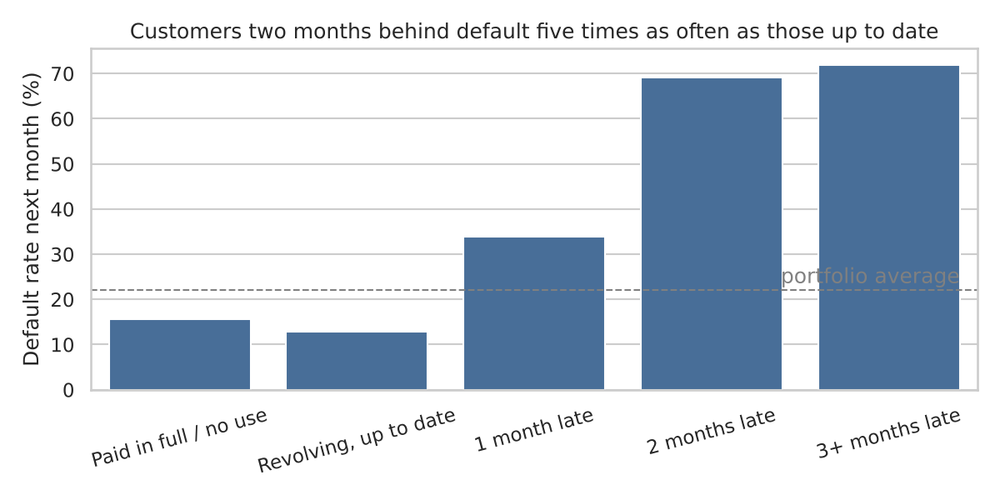
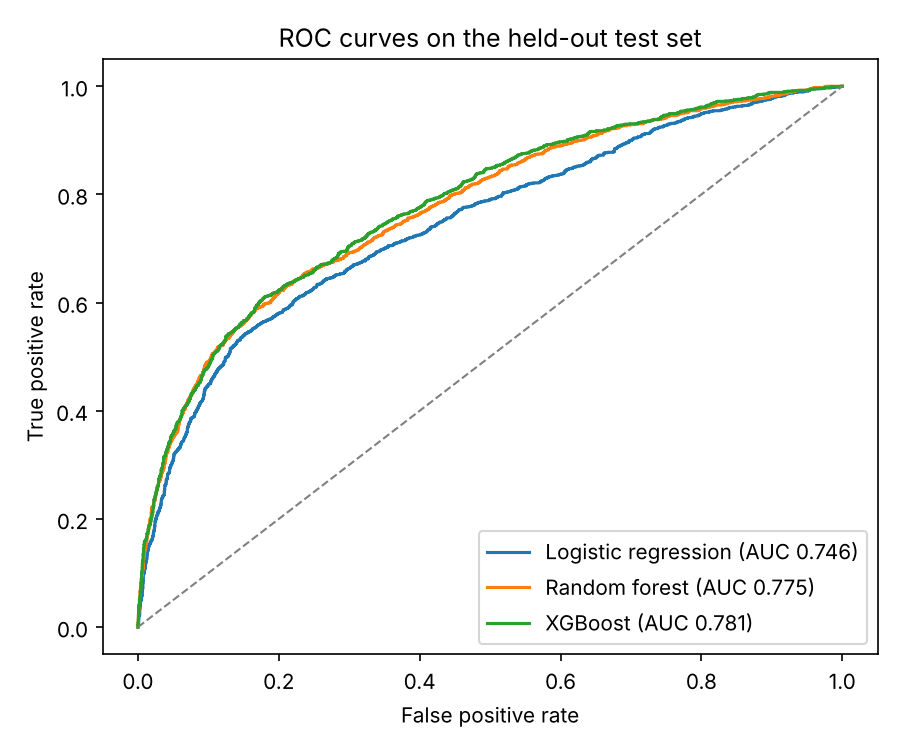
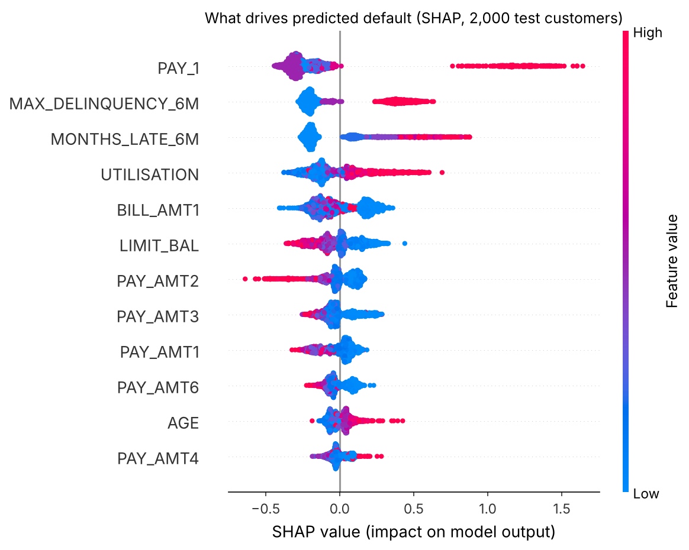
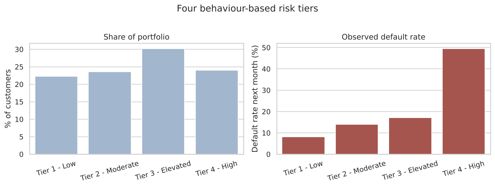

# Credit card default prediction and portfolio risk segmentation

An end-to-end card portfolio analytics case study. It uses SQL, Python and Excel to monitor portfolio KPIs, predict next-month default, split customers into risk tiers and suggest risk appetite metrics.


Every number in this README comes from the notebooks in this repo and can be reproduced.

## Business problem

A consumer lender wants to:

1. **Monitor** the performance of its card portfolio.
2. **Predict** which customers are likely to default next month.
3. **Segment** customers into risk tiers for credit-limit and collections strategy.
4. **Report** the findings clearly to non-technical stakeholders.

## Data

[UCI Default of Credit Card Clients](https://archive.ics.uci.edu/dataset/350/default+of+credit+card+clients) (Yeh and Lien, 2009), licensed CC BY 4.0.

- 30,000 card holders of a bank in Taiwan.
- Six months of history, April to September 2005. Amounts are in New Taiwan dollars (NT$).
- The target is default in October 2005. The portfolio default rate is **22.1%**.
- Features: credit limit, age, education, monthly repayment status, bill amounts and payments.

Cleaning (`src/prepare_data.py`): undocumented education and marital codes are grouped into "other", `PAY_0` is renamed `PAY_1`, and four behaviour features are added. These are utilisation, months late in six, worst arrears in six and the payment-to-bill ratio.

## Key findings

| Finding | Evidence |
| --- | --- |
| Arrears are the strongest warning sign | 69.6% of customers two or more months behind in September defaulted, against 13.8% of those not behind (5.0x) |
| Utilisation matters, but much less | Default rises from 18.3% below 30% utilisation to 30.1% above 100% |
| XGBoost is the best of three models | Test ROC-AUC 0.781, against 0.775 for random forest and 0.746 for logistic regression |
| One tier carries most of the loss | Tier 4 holds 24.0% of customers and 61.9% of the balance of customers who defaulted |

## Method

### 1. SQL KPI layer

`sql/02_portfolio_kpis.sql` runs against a SQLite copy of the data. It covers:

- portfolio overview: customers, default rate, limits, balances, utilisation
- default rate by utilisation band, September arrears status and age band
- August to September arrears roll rates (window function)
- balance share and cumulative share by credit-limit band (window functions)

### 2. Exploratory analysis

`notebooks/01_EDA.ipynb` charts the KPIs and the correlation of behaviour features with default.



### 3. Default prediction

`notebooks/02_default_prediction.ipynb` compares three models on the same stratified 80/20 split. Sex is left out because UK and EU law bars pricing credit on it. Marital status is left out as a fairness precaution. The F1-best threshold is chosen on out-of-fold training predictions, so the test set is never used for tuning.

| Model | Threshold | ROC-AUC | Precision | Recall | F1 |
| --- | --- | --- | --- | --- | --- |
| Logistic regression | 0.50 | 0.746 | 0.644 | 0.300 | 0.409 |
| Random forest | 0.50 | 0.775 | 0.654 | 0.358 | 0.463 |
| **XGBoost** | 0.50 | **0.781** | 0.669 | 0.361 | 0.469 |
| **XGBoost** | 0.28 (F1-best) | **0.781** | 0.517 | 0.567 | 0.541 |

At the 0.5 cut-off, the models catch only about a third of defaulters. Lowering the threshold to 0.28 raises XGBoost recall to 57% at the cost of precision. That trade-off is a business decision about the cost of a missed default against a false alarm.



### 4. Explainability with SHAP

SHAP values show what drives the XGBoost predictions. In order of mean impact:

1. September repayment status (`PAY_1`)
2. Worst arrears in the last six months
3. Number of months late in the last six
4. Utilisation
5. September bill amount and credit limit



### 5. Risk segmentation

`notebooks/03_risk_segmentation.ipynb` runs K-Means on five behaviour features and ranks the four clusters by observed default rate. Four clusters were chosen for business use. The silhouette score is slightly higher at three, and the notebook shows that trade-off.

| Tier | Share of customers | Default rate | Mean model PD | Profile | Suggested action |
| --- | --- | --- | --- | --- | --- |
| Tier 1, low | 22.3% | 8.1% | 8.7% | High limits, moderate use, rarely late | Eligible for limit increases |
| Tier 2, moderate | 23.6% | 14.0% | 13.8% | Lower limits, 85% utilisation, not late | Monitor utilisation |
| Tier 3, elevated | 30.2% | 17.1% | 16.9% | Very low balances, pays most of each bill | Light-touch engagement |
| Tier 4, high | 24.0% | 49.5% | 49.2% | Lower limits, about three late months in six | Early collections contact, limit review |



### 6. Candidate risk appetite metrics

| Metric | Share of customers | Default rate |
| --- | --- | --- |
| Utilisation at or above 80% | 26.6% | 26.7% |
| Two or more months in arrears (September) | 10.4% | 69.6% |
| Customers in Tier 4 | 24.0% | 49.5% |

### 7. Excel MI pack

`src/build_mi_pack.py` writes `excel/portfolio_mi_pack.xlsx`. It has nine sheets: overview, risk tiers, defaulted balance, the KPI breakdowns, risk appetite and model results. Default-rate columns carry a red-amber-green colour scale.

## Repository structure

```
credit-card-portfolio-analytics/
├── data/
│   ├── raw/default_of_credit_card_clients.csv     # UCI data, converted from .xls
│   ├── clean/credit_card_clients_clean.csv        # written by src/prepare_data.py
│   └── output/                                    # PD scores, tiers, model results
├── sql/
│   ├── 01_create_tables.sql
│   ├── 02_portfolio_kpis.sql
│   └── 03_segmentation_queries.sql
├── notebooks/
│   ├── 01_EDA.ipynb
│   ├── 02_default_prediction.ipynb
│   ├── 03_risk_segmentation.ipynb
│   └── src_py/                                    # plain-Python versions of the notebooks
├── src/
│   ├── prepare_data.py
│   └── build_mi_pack.py
├── excel/portfolio_mi_pack.xlsx
├── images/
└── requirements.txt
```

## How to run

```bash
git clone https://github.com/Samiurr129/credit-card-portfolio-analytics.git
cd credit-card-portfolio-analytics
pip install -r requirements.txt

python src/prepare_data.py          # clean the data and build data/portfolio.db
cd notebooks
jupyter nbconvert --to notebook --execute --inplace 01_EDA.ipynb 02_default_prediction.ipynb 03_risk_segmentation.ipynb
cd ..
python src/build_mi_pack.py         # write the Excel MI pack
```

Run the notebooks in order. Notebook 03 uses the PD scores written by notebook 02.

## Limitations

- The data is from one Taiwanese bank in 2005. Results show the method, not current UK portfolio behaviour.
- There are no account-opening dates, so vintage analysis is not possible.
- In this file, the "1 month late" status almost never appears from April to August. Roll rates out of that bucket are not reliable.
- The model was not tuned in depth or checked for fairness across age groups. Both would be needed before real use.

## Future work

- A Power BI dashboard built on the SQLite KPI layer
- IFRS 9 expected credit loss staging
- Fairness checks across age bands
- A Streamlit app for scoring single customers

## Author

**Samiur Rahman**, DBA candidate, University of Gloucestershire. Bradford, UK.

[LinkedIn](https://www.linkedin.com/in/samiur-rahman29/) · [GitHub](https://github.com/Samiurr129)

## Acknowledgements

Yeh, I. C. and Lien, C. H. (2009) 'The comparisons of data mining techniques for the predictive accuracy of probability of default of credit card clients', *Expert Systems with Applications*, 36(2), pp. 2473–2480.
